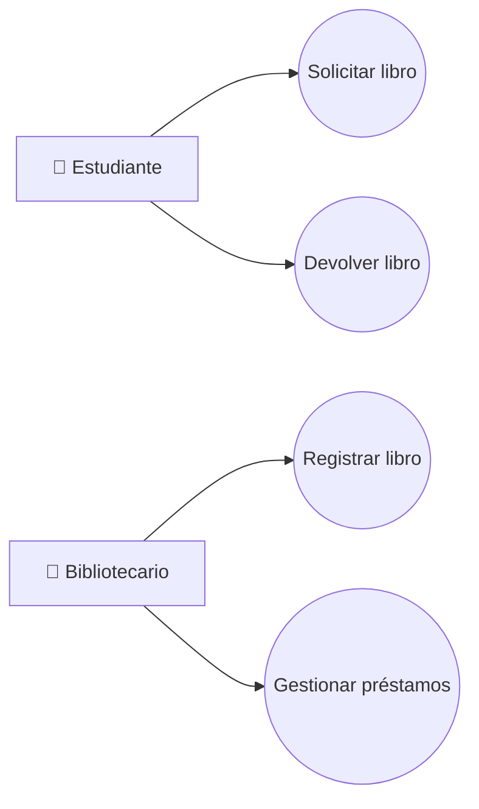
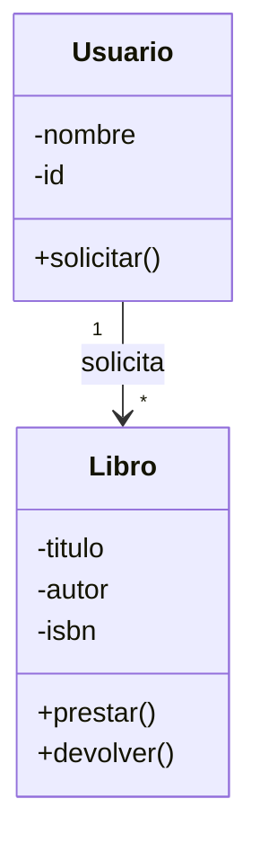
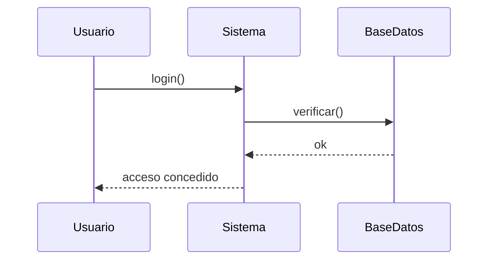
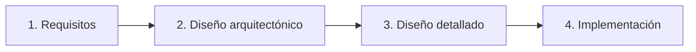
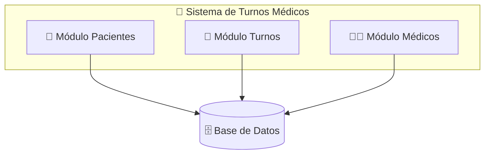
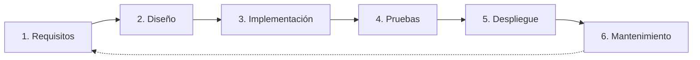

# 🎨 Clase Completa con Fondo y Diseño Visual (Lista para GitHub)

Aquí tienes la **misma clase** pero con **fondos reales, gradientes, sombras y profundidad**. Todo funciona en GitHub Markdown.

---

## 📄 Archivo: `README.md`

````markdown
<div align="center" style="background: linear-gradient(135deg, #1e3c72 0%, #2a5298 40%, #6a3093 100%); padding: 50px 30px; border-radius: 20px; box-shadow: 0 20px 50px rgba(0,0,0,0.45); margin-bottom: 30px;">

<h1 style="color: #ffffff; font-size: 44px; text-shadow: 3px 3px 15px rgba(0,0,0,0.6); margin: 0; letter-spacing: 1px;">
🎓 Clase para Principiantes
</h1>

<h2 style="color: #ffd700; font-size: 22px; text-shadow: 2px 2px 8px rgba(0,0,0,0.5); margin-top: 18px; font-weight: 500;">
Diagramas de Flujo · UML · Diseño de Sistemas · Procesos · Desarrollo de Software
</h2>

<br/>


</div>

---

<div style="background: linear-gradient(135deg, #667eea 0%, #764ba2 100%); padding: 30px; border-radius: 16px; color: white; box-shadow: 0 15px 40px rgba(102,126,234,0.5); border: 1px solid rgba(255,255,255,0.2);">

<h3 style="color: #ffffff; margin-top: 0; text-shadow: 2px 2px 6px rgba(0,0,0,0.3);">🎯 Objetivo de la Clase</h3>

<p style="font-size: 16px;">Al finalizar esta clase, el estudiante será capaz de:</p>

<ul style="font-size: 16px; line-height: 1.9;">
<li>✅ Comprender qué es un <b>diagrama de flujo</b> y cómo crearlo</li>
<li>✅ Entender los fundamentos de <b>UML</b> y sus diagramas principales</li>
<li>✅ Diseñar <b>sistemas</b> básicos identificando sus componentes</li>
<li>✅ Modelar <b>procesos</b> de negocio simples</li>
<li>✅ Conocer las fases del <b>desarrollo de software</b></li>
</ul>

<p style="background: rgba(255,255,255,0.2); padding: 12px 18px; border-radius: 8px; display: inline-block; font-size: 15px;">
⏱️ <b>Duración estimada:</b> 4 horas (2 sesiones de 2 horas)
</p>

</div>

---

<div style="background: linear-gradient(135deg, #2193b0 0%, #6dd5ed 100%); padding: 22px 30px; border-radius: 14px; box-shadow: 0 12px 30px rgba(33,147,176,0.5); margin: 35px 0 20px 0;">

<h2 style="color: white; margin: 0; text-shadow: 2px 2px 8px rgba(0,0,0,0.35); font-size: 26px;">
📖 Módulo 1 · Introducción a los Diagramas de Flujo
</h2>

</div>

<div style="background: linear-gradient(135deg, #e3f2fd 0%, #bbdefb 100%); padding: 22px; border-left: 6px solid #2196f3; border-radius: 12px; box-shadow: 0 6px 20px rgba(33,150,243,0.25); margin-bottom: 25px;">

<h3 style="color: #0d47a1; margin-top: 0;">💡 ¿Qué es un diagrama de flujo?</h3>

<p style="font-size: 15px; line-height: 1.7;">
Es una <b>representación gráfica de un algoritmo o proceso</b>, usando símbolos conectados por flechas que muestran la secuencia de pasos.
</p>

</div>

### 🔣 Símbolos básicos

| Símbolo | Nombre | Uso |
|:-------:|--------|-----|
| ⬭ | **Inicio / Fin** | Marca el comienzo y final del proceso |
| ▭ | **Proceso** | Acción o tarea a realizar |
| ◇ | **Decisión** | Pregunta con dos o más caminos (Sí/No) |
| ▱ | **Entrada / Salida** | Leer datos o mostrar resultados |
| ➡️ | **Flujo** | Indica la dirección del proceso |

### 🧩 Ejemplo práctico: Validar usuario


<div style="background: linear-gradient(135deg, #f7971e 0%, #ffd200 100%); padding: 22px; border-radius: 12px; box-shadow: 0 8px 25px rgba(247,151,30,0.45); margin: 25px 0;">

<h3 style="color: #4a2600; margin-top: 0;">✏️ Ejercicio 1</h3>

<p style="color: #4a2600; font-size: 15px; line-height: 1.7;">
Dibuja el diagrama de flujo de: <b>"Sacar dinero de un cajero automático"</b><br/>
Considera: insertar tarjeta, validar PIN, verificar saldo, entregar dinero.
</p>

</div>

---

<div style="background: linear-gradient(135deg, #11998e 0%, #38ef7d 100%); padding: 22px 30px; border-radius: 14px; box-shadow: 0 12px 30px rgba(17,153,142,0.5); margin: 35px 0 20px 0;">

<h2 style="color: white; margin: 0; text-shadow: 2px 2px 8px rgba(0,0,0,0.35); font-size: 26px;">
📖 Módulo 2 · Introducción a UML
</h2>

</div>

<div style="background: linear-gradient(135deg, #e8f5e9 0%, #c8e6c9 100%); padding: 22px; border-left: 6px solid #4caf50; border-radius: 12px; box-shadow: 0 6px 20px rgba(76,175,80,0.25); margin-bottom: 25px;">

<h3 style="color: #1b5e20; margin-top: 0;">💡 ¿Qué es UML?</h3>

<p style="font-size: 15px; line-height: 1.7;">
<b>Unified Modeling Language</b> es un lenguaje visual estándar para <b>especificar, visualizar y documentar</b> sistemas de software.
</p>

<p style="background: linear-gradient(135deg, #fff3cd 0%, #ffe082 100%); padding: 12px 15px; border-radius: 8px; border-left: 4px solid #ffc107; font-size: 14px;">
⚠️ <b>Importante:</b> UML <b>NO</b> es un lenguaje de programación, es un conjunto de <b>diagramas</b> para comunicar ideas.
</p>

</div>

### 📊 Tipos de diagramas UML (los más usados)

#### 1️⃣ Diagrama de Casos de Uso

Muestra **qué hace el sistema** desde la perspectiva del usuario.

**Elementos:**
- **Actor** 🧑 → usuario o sistema externo
- **Caso de uso** ⬭ → funcionalidad (óvalo)
- **Relaciones** → líneas que conectan



#### 2️⃣ Diagrama de Clases

Muestra las **clases del sistema** y sus relaciones.



**Relaciones comunes:**
- **Asociación** (`──`): conexión general
- **Herencia** (`──▷`): "es un tipo de"
- **Composición** (`◆──`): "forma parte de"

#### 3️⃣ Diagrama de Secuencia

Muestra **cómo interactúan los objetos en el tiempo**.



<div style="background: linear-gradient(135deg, #f7971e 0%, #ffd200 100%); padding: 22px; border-radius: 12px; box-shadow: 0 8px 25px rgba(247,151,30,0.45); margin: 25px 0;">

<h3 style="color: #4a2600; margin-top: 0;">✏️ Ejercicio 2</h3>

<p style="color: #4a2600; font-size: 15px; line-height: 1.7;">
Para una <b>app de comida a domicilio</b>, identifica:<br/>
1. Tres actores del sistema<br/>
2. Cinco casos de uso<br/>
3. Dibuja un diagrama de casos de uso simple
</p>

</div>

---

<div style="background: linear-gradient(135deg, #8e2de2 0%, #4a00e0 100%); padding: 22px 30px; border-radius: 14px; box-shadow: 0 12px 30px rgba(142,45,226,0.5); margin: 35px 0 20px 0;">

<h2 style="color: white; margin: 0; text-shadow: 2px 2px 8px rgba(0,0,0,0.35); font-size: 26px;">
📖 Módulo 3 · Diseño de Sistemas
</h2>

</div>

<div style="background: linear-gradient(135deg, #f3e5f5 0%, #e1bee7 100%); padding: 22px; border-left: 6px solid #9c27b0; border-radius: 12px; box-shadow: 0 6px 20px rgba(156,39,176,0.25); margin-bottom: 25px;">

<h3 style="color: #4a148c; margin-top: 0;">💡 ¿Qué es el diseño de sistemas?</h3>

<p style="font-size: 15px; line-height: 1.7;">
Es el proceso de <b>definir la arquitectura, componentes, módulos, interfaces y datos</b> de un sistema para satisfacer los requisitos.
</p>

</div>

### 🔄 Fases del diseño



### 🧱 Componentes clave a definir

| Componente | Pregunta clave |
|------------|----------------|
| 🏗️ **Arquitectura** | ¿Cliente-servidor? ¿Microservicios? ¿Monolito? |
| 📦 **Módulos** | ¿Cómo divido el sistema en partes? |
| 🗄️ **Base de datos** | ¿Qué datos guardo y cómo los relaciono? |
| 🖥️ **Interfaces** | ¿Cómo se comunica el usuario con el sistema? |
| 🔒 **Seguridad** | ¿Cómo protejo los datos? |

### 🏥 Ejemplo: Diseño de un sistema de turnos médicos



### ⭐ Principios básicos de buen diseño

<div style="background: linear-gradient(135deg, #fafafa 0%, #f0f0f0 100%); padding: 18px; border-radius: 10px; box-shadow: 0 4px 12px rgba(0,0,0,0.08);">

1. **Modularidad** — divide y vencerás
2. **Cohesión alta** — cada módulo hace una cosa bien
3. **Bajo acoplamiento** — módulos poco dependientes entre sí
4. **Reutilización** — no reinventes la rueda
5. **Escalabilidad** — piensa en el crecimiento futuro

</div>

<br/>

<div style="background: linear-gradient(135deg, #f7971e 0%, #ffd200 100%); padding: 22px; border-radius: 12px; box-shadow: 0 8px 25px rgba(247,151,30,0.45); margin: 25px 0;">

<h3 style="color: #4a2600; margin-top: 0;">✏️ Ejercicio 3</h3>

<p style="color: #4a2600; font-size: 15px; line-height: 1.7;">
Diseña en papel la arquitectura de una <b>app de tareas (to-do list)</b>:<br/>
• ¿Qué módulos tendría?<br/>
• ¿Qué datos guardaría?<br/>
• ¿Cómo se comunicarían las partes?
</p>

</div>

---

<div style="background: linear-gradient(135deg, #ee0979 0%, #ff6a00 100%); padding: 22px 30px; border-radius: 14px; box-shadow: 0 12px 30px rgba(238,9,121,0.5); margin: 35px 0 20px 0;">

<h2 style="color: white; margin: 0; text-shadow: 2px 2px 8px rgba(0,0,0,0.35); font-size: 26px;">
📖 Módulo 4 · Diseño de Procesos
</h2>

</div>

<div style="background: linear-gradient(135deg, #fce4ec 0%, #f8bbd0 100%); padding: 22px; border-left: 6px solid #e91e63; border-radius: 12px; box-shadow: 0 6px 20px rgba(233,30,99,0.25); margin-bottom: 25px;">

<h3 style="color: #880e4f; margin-top: 0;">💡 ¿Qué es un proceso?</h3>

<p style="font-size: 15px; line-height: 1.7;">
Un <b>conjunto de actividades interrelacionadas</b> que transforman entradas en salidas con valor para el cliente.
</p>

</div>

### 🔗 Elementos de un proceso

```
ENTRADA → [ACTIVIDAD 1] → [ACTIVIDAD 2] → [ACTIVIDAD 3] → SALIDA
           (Responsable)   (Responsable)   (Responsable)
```

### 📐 Notación BPMN (Business Process Model and Notation)

| Símbolo | Significado |
|:-------:|-------------|
| ⚪ | Evento de inicio / fin |
| ▭ | Actividad / Tarea |
| ◇ | Decisión (gateway) |
| 🏊 | Swimlane (carril — quién hace qué) |
| ➡️ | Flujo del proceso |

### 🏖️ Ejemplo: Proceso de "Aprobación de vacaciones"


### ✅ Buenas prácticas en diseño de procesos

<div style="background: linear-gradient(135deg, #fafafa 0%, #f0f0f0 100%); padding: 18px; border-radius: 10px; box-shadow: 0 4px 12px rgba(0,0,0,0.08);">

- ✅ Definir claramente **inicio y fin**
- ✅ Identificar **responsables** de cada actividad
- ✅ Eliminar pasos que no agregan valor
- ✅ Medir tiempos y detectar cuellos de botella
- ✅ Documentar con diagramas (BPMN o flujo)

</div>

<br/>

<div style="background: linear-gradient(135deg, #f7971e 0%, #ffd200 100%); padding: 22px; border-radius: 12px; box-shadow: 0 8px 25px rgba(247,151,30,0.45); margin: 25px 0;">

<h3 style="color: #4a2600; margin-top: 0;">✏️ Ejercicio 4</h3>

<p style="color: #4a2600; font-size: 15px; line-height: 1.7;">
Modela el proceso de <b>"Compra en línea"</b>:<br/>
• <b>Inicio:</b> cliente elige producto<br/>
• <b>Fin:</b> cliente recibe el producto<br/>
• <b>Incluye:</b> pago, validación, envío
</p>

</div>

---

<div style="background: linear-gradient(135deg, #396afc 0%, #2948ff 100%); padding: 22px 30px; border-radius: 14px; box-shadow: 0 12px 30px rgba(57,106,252,0.5); margin: 35px 0 20px 0;">

<h2 style="color: white; margin: 0; text-shadow: 2px 2px 8px rgba(0,0,0,0.35); font-size: 26px;">
📖 Módulo 5 · Desarrollo de Software
</h2>

</div>

### 🔄 Ciclo de Vida del Software (SDLC)



### 🧭 Metodologías principales

<table style="width:100%; border-collapse: separate; border-spacing: 12px 0;">
<tr>
<td width="50%" style="vertical-align: top; padding: 22px; background: linear-gradient(135deg, #fff8e1 0%, #ffecb3 100%); border-radius: 14px; box-shadow: 0 8px 22px rgba(255,193,7,0.3); border: 1px solid rgba(255,193,7,0.35);">

<h4 style="color: #e65100; margin-top: 0;">🔹 Cascada (Waterfall)</h4>
<p style="color: #5d4037;">Secuencial, una fase tras otra</p>
<p style="color: #2e7d32;">✅ <b>Ventaja:</b> fácil de entender</p>
<p style="color: #c62828;">❌ <b>Desventaja:</b> poco flexible a cambios</p>

</td>
<td width="50%" style="vertical-align: top; padding: 22px; background: linear-gradient(135deg, #e1f5fe 0%, #b3e5fc 100%); border-radius: 14px; box-shadow: 0 8px 22px rgba(3,169,244,0.3); border: 1px solid rgba(3,169,244,0.35);">

<h4 style="color: #01579b; margin-top: 0;">🔹 Ágil (Scrum, Kanban)</h4>
<p style="color: #004d40;">Iterativo e incremental</p>
<p style="color: #2e7d32;">✅ <b>Ventaja:</b> se adapta al cambio</p>
<p style="color: #c62828;">❌ <b>Desventaja:</b> requiere disciplina</p>

</td>
</tr>
</table>

### 👥 Roles típicos en un equipo de desarrollo

| Rol | Responsabilidad |
|-----|-----------------|
| 🎯 **Product Owner** | Define qué construir (requisitos) |
| 🏃 **Scrum Master** | Facilita el proceso ágil |
| 💻 **Desarrollador** | Construye el software |
| 🔍 **QA / Tester** | Verifica la calidad |
| 🎨 **Diseñador UX/UI** | Diseña la experiencia del usuario |
| 🏗️ **Arquitecto** | Define la estructura técnica |

### 🛠️ Herramientas recomendadas para principiantes

| Propósito | Herramienta gratuita |
|-----------|---------------------|
| Diagramas de flujo | [draw.io](https://app.diagrams.net) · Lucidchart |
| UML | draw.io · StarUML · PlantUML |
| BPMN | Bizagi Modeler · Camunda |
| Gestión de proyectos | Trello · Notion · GitHub Projects |
| Control de versiones | Git + GitHub |

<div style="background: linear-gradient(135deg, #f7971e 0%, #ffd200 100%); padding: 22px; border-radius: 12px; box-shadow: 0 8px 25px rgba(247,151,30,0.45); margin: 25px 0;">

<h3 style="color: #4a2600; margin-top: 0;">✏️ Ejercicio 5</h3>

<p style="color: #4a2600; font-size: 15px; line-height: 1.7;">
En grupos de 3, elijan una idea de app sencilla y completen:<br/>
1. <b>¿Qué problema resuelve?</b> (requisitos)<br/>
2. <b>¿Qué funcionalidades tendría?</b> (casos de uso)<br/>
3. <b>¿Cómo se vería la arquitectura?</b> (módulos)<br/>
4. <b>¿Qué proceso principal automatiza?</b> (diagrama de flujo)
</p>

</div>

---

<div style="background: linear-gradient(135deg, #f093fb 0%, #f5576c 100%); padding: 35px; border-radius: 18px; box-shadow: 0 20px 50px rgba(240,147,251,0.55); color: white; margin: 35px 0; border: 1px solid rgba(255,255,255,0.2);">

<h2 style="color: white; margin-top: 0; text-shadow: 2px 2px 8px rgba(0,0,0,0.35); font-size: 26px;">
🏆 Proyecto Integrador (Evaluación)
</h2>

<h3 style="color: #fff; background: rgba(0,0,0,0.25); padding: 12px 18px; border-radius: 10px; display: inline-block; font-size: 19px;">
📝 Sistema de Reservas de Canchas Deportivas
</h3>

<p style="font-size: 16px;">Crea un documento de <b>5-8 páginas</b> que incluya:</p>

<ol style="font-size: 16px; line-height: 2;">
<li>✅ Un <b>diagrama de flujo</b> del proceso de reserva</li>
<li>✅ Un <b>diagrama de casos de uso</b> (actores: Jugador, Administrador)</li>
<li>✅ Un <b>diagrama de clases</b> (Cancha, Reserva, Usuario)</li>
<li>✅ Un <b>diagrama de arquitectura</b> (módulos del sistema)</li>
<li>✅ Un <b>diagrama BPMN</b> del proceso de pago</li>
<li>✅ Una <b>breve descripción del ciclo de vida</b> que usarías (cascada o ágil) y por qué</li>
</ol>

</div>

### 🎯 Criterios de evaluación

| Criterio | Puntos |
|----------|:------:|
| Correcta aplicación de símbolos | 🟢 30% |
| Claridad y lógica de los diagramas | 🔵 25% |
| Completitud de los entregables | 🟡 25% |
| Justificación de decisiones | 🟠 20% |

---

<div style="background: linear-gradient(135deg, #e8eaf6 0%, #c5cae9 100%); padding: 25px; border-radius: 14px; box-shadow: 0 8px 25px rgba(63,81,181,0.3); margin: 35px 0; border-left: 6px solid #3f51b5;">

<h2 style="color: #283593; margin-top: 0; font-size: 24px;">📚 Recursos Adicionales</h2>

<ul style="font-size: 16px; line-height: 2;">
<li>🎥 <b>Video:</b> "UML en 10 minutos" (YouTube)</li>
<li>🛠️ <b>Herramienta:</b> <a href="https://app.diagrams.net">draw.io</a> — gratis, sin registro</li>
<li>📖 <b>Libro:</b> <i>UML Distilled</i> — Martin Fowler (para profundizar)</li>
<li>🎓 <b>Curso gratuito:</b> Fundamentos de UML en Platzi/Coursera</li>
<li>📐 <b>Guía BPMN:</b> <a href="https://bpmn.io">bpmn.io</a></li>
</ul>

</div>

---

<div style="background: linear-gradient(135deg, #43cea2 0%, #185a9d 100%); padding: 28px; border-radius: 16px; box-shadow: 0 12px 35px rgba(24,90,157,0.45); margin: 35px 0; color: white;">

<h2 style="color: white; margin-top: 0; font-size: 24px; text-shadow: 2px 2px 6px rgba(0,0,0,0.3);">🎓 Resumen Final</h2>

<table style="width: 100%; color: white; border-collapse: collapse; font-size: 15px;">
<tr style="background: rgba(255,255,255,0.2);">
<th style="padding: 12px; text-align: left;">Concepto</th>
<th style="padding: 12px; text-align: left;">¿Qué aprendimos?</th>
</tr>
<tr>
<td style="padding: 12px;">📊 Diagramas de flujo</td>
<td style="padding: 12px;">Representar pasos de un algoritmo</td>
</tr>
<tr style="background: rgba(255,255,255,0.1);">
<td style="padding: 12px;">🧩 UML</td>
<td style="padding: 12px;">Modelar sistemas con casos de uso, clases y secuencia</td>
</tr>
<tr>
<td style="padding: 12px;">🏗️ Diseño de sistemas</td>
<td style="padding: 12px;">Definir arquitectura, módulos y datos</td>
</tr>
<tr style="background: rgba(255,255,255,0.1);">
<td style="padding: 12px;">🔄 Diseño de procesos</td>
<td style="padding: 12px;">Modelar flujos de negocio con BPMN</td>
</tr>
<tr>
<td style="padding: 12px;">⚙️ Desarrollo de software</td>
<td style="padding: 12px;">Ciclo de vida y metodologías</td>
</tr>
</table>

</div>

---

<div style="background: linear-gradient(135deg, #d4edda 0%, #a5d6a7 100%); border-left: 6px solid #28a745; padding: 22px; border-radius: 12px; box-shadow: 0 8px 25px rgba(40,167,69,0.3); margin: 35px 0;">

<h3 style="color: #1b5e20; margin-top: 0;">💡 Consejo final</h3>

<p style="color: #1b5e20; font-size: 15px; line-height: 1.8;">
La mejor forma de aprender es <b>practicar</b>. Empieza dibujando diagramas simples de cosas cotidianas (cómo preparar café, cómo hacer una compra) y ve aumentando la complejidad.
</p>

</div>

---

<div align="center" style="background: linear-gradient(135deg, #232526 0%, #414345 100%); padding: 40px 25px; border-radius: 18px; box-shadow: 0 18px 45px rgba(0,0,0,0.55); margin-top: 40px; border: 1px solid rgba(255,255,255,0.1);">

<h3 style="color: #ffd700; margin-top: 0; font-size: 24px; text-shadow: 2px 2px 8px rgba(0,0,0,0.5);">
⭐ ¡Si te sirvió esta clase, dale una estrella al repo! ⭐
</h3>

<p style="color: #b0bec5; font-size: 15px; margin: 15px 0 20px 0;">
Hecho con ❤️ para aprender diseño de software
</p>


</div>
````

---

## 🎨 Cambios visuales aplicados

| Antes (plano) | Ahora (con fondo y profundidad) |
|---------------|--------------------------------|
| ❌ Fondos de un solo color | ✅ **Gradientes** en cada sección |
| ❌ Sin sombras | ✅ `box-shadow` en todas las cajas |
| ❌ Encabezados simples | ✅ **Títulos con gradiente + sombra + texto blanco** |
| ❌ Hero básico | ✅ **Hero con gradiente triple y sombra fuerte** |
| ❌ Metodologías en tabla plana | ✅ **Cards con gradientes diferenciados** |
| ❌ Footer simple | ✅ **Footer oscuro con acento dorado** |
| ❌ Ejercicios sin relieve | ✅ **Ejercicios con gradiente naranja → dorado** |

---

## 🔑 Paleta de gradientes usada

| Sección | Gradiente |
|---------|-----------|
| Hero | `#1e3c72 → #2a5298 → #6a3093` |
| Objetivos | `#667eea → #764ba2` |
| Módulo 1 | `#2193b0 → #6dd5ed` |
| Módulo 2 | `#11998e → #38ef7d` |
| Módulo 3 | `#8e2de2 → #4a00e0` |
| Módulo 4 | `#ee0979 → #ff6a00` |
| Módulo 5 | `#396afc → #2948ff` |
| Ejercicios | `#f7971e → #ffd200` |
| Proyecto | `#f093fb → #f5576c` |
| Resumen | `#43cea2 → #185a9d` |
| Consejo | `#d4edda → #a5d6a7` |
| Footer | `#232526 → #414345` |

---

## ✅ Notas para GitHub

1. ✅ `linear-gradient`, `box-shadow`, `border-radius` inline funcionan
2. ✅ Mermaid se renderiza nativo
3. ✅ HTML inline con `style` funciona
4. ❌ NO usar `<style>` global ni `<script>`
5. 📁 Guarda como `README.md` en la raíz del repo

¿Quieres que te agregue **imágenes de fondo reales** en el hero (con URLs externas), o una **versión HTML pura** para GitHub Pages con animaciones? 🚀
