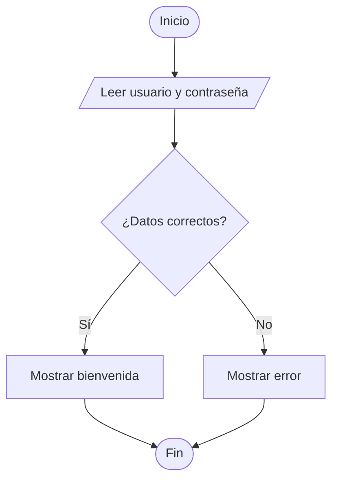
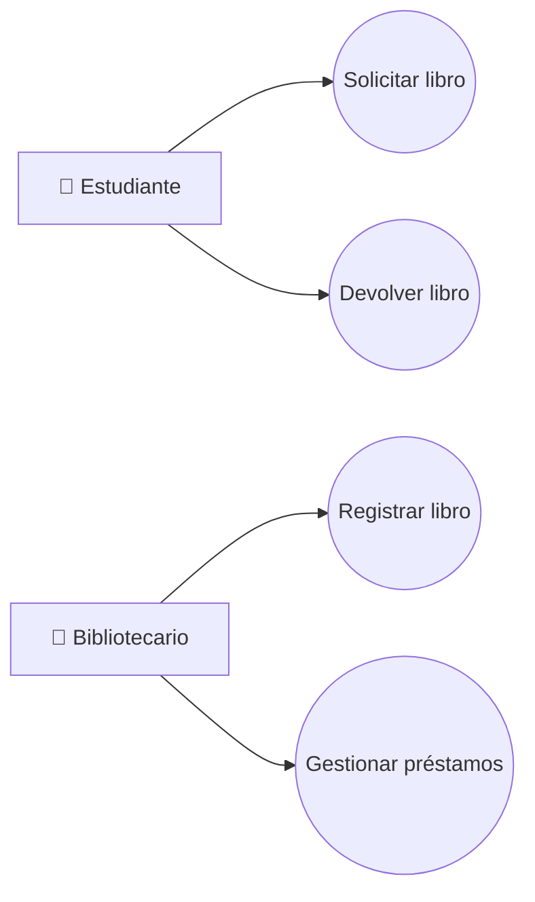
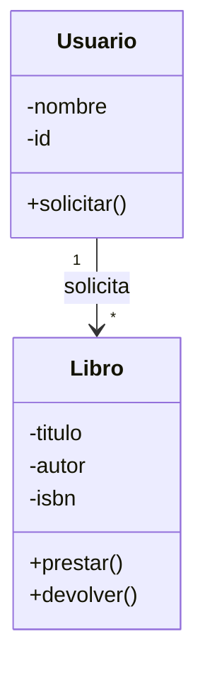
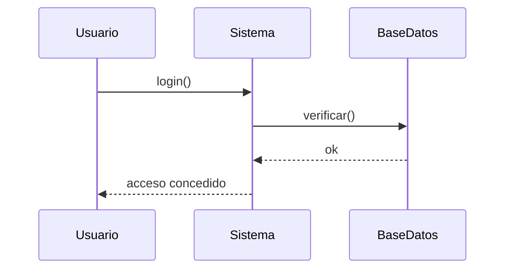
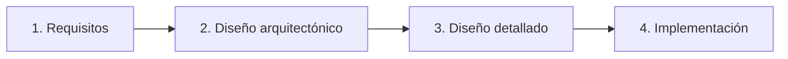
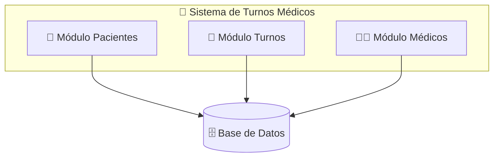
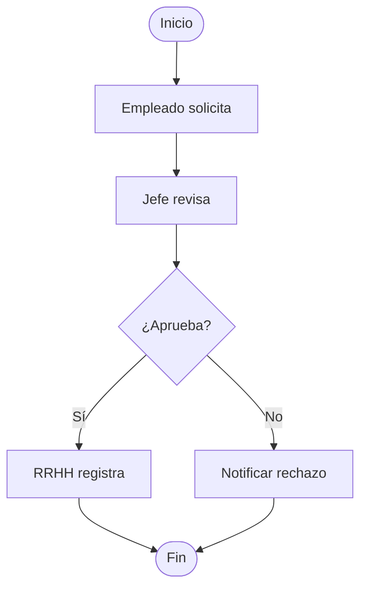
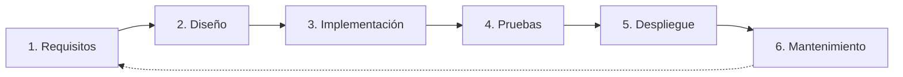

# 📚 Clase Completa: Diagramas de Flujo, UML, Diseño de Sistemas, Procesos y Desarrollo de Software

Aquí tienes la clase completa con **diseño HTML embebido** (colores, cajas, estilos) listo para tu repositorio de GitHub. Todo funciona en archivos `.md`.

---

## 📄 Archivo: `README.md` (o `clase.md`)

````markdown
<div align="center">

# 🎓 Clase para Principiantes
## Diagramas de Flujo · UML · Diseño de Sistemas · Procesos · Desarrollo de Software


</div>

---

<div style="background: linear-gradient(135deg, #667eea 0%, #764ba2 100%); padding: 20px; border-radius: 12px; color: white;">

### 🎯 Objetivo de la Clase

Al finalizar esta clase, el estudiante será capaz de:

- ✅ Comprender qué es un **diagrama de flujo** y cómo crearlo
- ✅ Entender los fundamentos de **UML** y sus diagramas principales
- ✅ Diseñar **sistemas** básicos identificando sus componentes
- ✅ Modelar **procesos** de negocio simples
- ✅ Conocer las fases del **desarrollo de software**

**Duración estimada:** 4 horas (puede dividirse en 2 sesiones de 2 horas)

</div>

---

## 📖 Módulo 1 · Introducción a los Diagramas de Flujo

<div style="background:#e3f2fd; border-left: 5px solid #2196f3; padding: 15px; border-radius: 6px;">

### 💡 ¿Qué es un diagrama de flujo?

Es una **representación gráfica de un algoritmo o proceso**, usando símbolos conectados por flechas que muestran la secuencia de pasos.

</div>

### 🔣 Símbolos básicos

| Símbolo | Nombre | Uso |
|:-------:|--------|-----|
| ⬭ | **Inicio / Fin** | Marca el comienzo y final del proceso |
| ▭ | **Proceso** | Acción o tarea a realizar |
| ◇ | **Decisión** | Pregunta con dos o más caminos (Sí/No) |
| ▱ | **Entrada / Salida** | Leer datos o mostrar resultados |
| ➡️ | **Flujo** | Indica la dirección del proceso |

### 🧩 Ejemplo práctico: Validar usuario



<div style="background:#fff3e0; border-left: 5px solid #ff9800; padding: 15px; border-radius: 6px;">

### ✏️ Ejercicio 1

Dibuja el diagrama de flujo de: **"Sacar dinero de un cajero automático"**
Considera: insertar tarjeta, validar PIN, verificar saldo, entregar dinero.

</div>

---

## 📖 Módulo 2 · Introducción a UML

<div style="background:#e8f5e9; border-left: 5px solid #4caf50; padding: 15px; border-radius: 6px;">

### 💡 ¿Qué es UML?

**Unified Modeling Language** es un lenguaje visual estándar para **especificar, visualizar y documentar** sistemas de software.

> ⚠️ **Importante:** UML **NO** es un lenguaje de programación, es un conjunto de **diagramas** para comunicar ideas.

</div>

### 📊 Tipos de diagramas UML (los más usados)

#### 1️⃣ Diagrama de Casos de Uso

Muestra **qué hace el sistema** desde la perspectiva del usuario.

**Elementos:**
- **Actor** 🧑 → usuario o sistema externo
- **Caso de uso** ⬭ → funcionalidad (óvalo)
- **Relaciones** → líneas que conectan



#### 2️⃣ Diagrama de Clases

Muestra las **clases del sistema** y sus relaciones.



**Relaciones comunes:**
- **Asociación** (`──`): conexión general
- **Herencia** (`──▷`): "es un tipo de"
- **Composición** (`◆──`): "forma parte de"

#### 3️⃣ Diagrama de Secuencia

Muestra **cómo interactúan los objetos en el tiempo**.



<div style="background:#fff3e0; border-left: 5px solid #ff9800; padding: 15px; border-radius: 6px;">

### ✏️ Ejercicio 2

Para una **app de comida a domicilio**, identifica:
1. Tres actores del sistema
2. Cinco casos de uso
3. Dibuja un diagrama de casos de uso simple

</div>

---

## 📖 Módulo 3 · Diseño de Sistemas

<div style="background:#f3e5f5; border-left: 5px solid #9c27b0; padding: 15px; border-radius: 6px;">

### 💡 ¿Qué es el diseño de sistemas?

Es el proceso de **definir la arquitectura, componentes, módulos, interfaces y datos** de un sistema para satisfacer los requisitos.

</div>

### 🔄 Fases del diseño



### 🧱 Componentes clave a definir

| Componente | Pregunta clave |
|------------|----------------|
| 🏗️ **Arquitectura** | ¿Cliente-servidor? ¿Microservicios? ¿Monolito? |
| 📦 **Módulos** | ¿Cómo divido el sistema en partes? |
| 🗄️ **Base de datos** | ¿Qué datos guardo y cómo los relaciono? |
| 🖥️ **Interfaces** | ¿Cómo se comunica el usuario con el sistema? |
| 🔒 **Seguridad** | ¿Cómo protejo los datos? |

### 🏥 Ejemplo: Diseño de un sistema de turnos médicos



### ⭐ Principios básicos de buen diseño

1. **Modularidad** — divide y vencerás
2. **Cohesión alta** — cada módulo hace una cosa bien
3. **Bajo acoplamiento** — módulos poco dependientes entre sí
4. **Reutilización** — no reinventes la rueda
5. **Escalabilidad** — piensa en el crecimiento futuro

<div style="background:#fff3e0; border-left: 5px solid #ff9800; padding: 15px; border-radius: 6px;">

### ✏️ Ejercicio 3

Diseña en papel la arquitectura de una **app de tareas (to-do list)**:
- ¿Qué módulos tendría?
- ¿Qué datos guardaría?
- ¿Cómo se comunicarían las partes?

</div>

---

## 📖 Módulo 4 · Diseño de Procesos

<div style="background:#fce4ec; border-left: 5px solid #e91e63; padding: 15px; border-radius: 6px;">

### 💡 ¿Qué es un proceso?

Un **conjunto de actividades interrelacionadas** que transforman entradas en salidas con valor para el cliente.

</div>

### 🔗 Elementos de un proceso

```
ENTRADA → [ACTIVIDAD 1] → [ACTIVIDAD 2] → [ACTIVIDAD 3] → SALIDA
           (Responsable)   (Responsable)   (Responsable)
```

### 📐 Notación BPMN (Business Process Model and Notation)

Es el estándar para modelar procesos de negocio.

| Símbolo | Significado |
|:-------:|-------------|
| ⚪ | Evento de inicio / fin |
| ▭ | Actividad / Tarea |
| ◇ | Decisión (gateway) |
| 🏊 | Swimlane (carril — quién hace qué) |
| ➡️ | Flujo del proceso |

### 🏖️ Ejemplo: Proceso de "Aprobación de vacaciones"



### ✅ Buenas prácticas en diseño de procesos

- ✅ Definir claramente **inicio y fin**
- ✅ Identificar **responsables** de cada actividad
- ✅ Eliminar pasos que no agregan valor
- ✅ Medir tiempos y detectar cuellos de botella
- ✅ Documentar con diagramas (BPMN o flujo)

<div style="background:#fff3e0; border-left: 5px solid #ff9800; padding: 15px; border-radius: 6px;">

### ✏️ Ejercicio 4

Modela el proceso de **"Compra en línea"**:
- **Inicio:** cliente elige producto
- **Fin:** cliente recibe el producto
- **Incluye:** pago, validación, envío

</div>

---

## 📖 Módulo 5 · Desarrollo de Software

### 🔄 Ciclo de Vida del Software (SDLC)



### 🧭 Metodologías principales

<table>
<tr>
<td width="50%" style="vertical-align: top; padding: 15px; background:#fff8e1; border-radius: 8px;">

#### 🔹 Cascada (Waterfall)
- Secuencial, una fase tras otra
- ✅ **Ventaja:** fácil de entender
- ❌ **Desventaja:** poco flexible a cambios

</td>
<td width="50%" style="vertical-align: top; padding: 15px; background:#e1f5fe; border-radius: 8px;">

#### 🔹 Ágil (Scrum, Kanban)
- Iterativo e incremental
- Entregas frecuentes
- ✅ **Ventaja:** se adapta al cambio
- ❌ **Desventaja:** requiere disciplina del equipo

</td>
</tr>
</table>

### 👥 Roles típicos en un equipo de desarrollo

| Rol | Responsabilidad |
|-----|-----------------|
| 🎯 **Product Owner** | Define qué construir (requisitos) |
| 🏃 **Scrum Master** | Facilita el proceso ágil |
| 💻 **Desarrollador** | Construye el software |
| 🔍 **QA / Tester** | Verifica la calidad |
| 🎨 **Diseñador UX/UI** | Diseña la experiencia del usuario |
| 🏗️ **Arquitecto** | Define la estructura técnica |

### 🛠️ Herramientas recomendadas para principiantes

| Propósito | Herramienta gratuita |
|-----------|---------------------|
| Diagramas de flujo | [draw.io](https://app.diagrams.net) · Lucidchart |
| UML | draw.io · StarUML · PlantUML |
| BPMN | Bizagi Modeler · Camunda |
| Gestión de proyectos | Trello · Notion · GitHub Projects |
| Control de versiones | Git + GitHub |

<div style="background:#fff3e0; border-left: 5px solid #ff9800; padding: 15px; border-radius: 6px;">

### ✏️ Ejercicio 5

En grupos de 3, elijan una idea de app sencilla y completen:
1. **¿Qué problema resuelve?** (requisitos)
2. **¿Qué funcionalidades tendría?** (casos de uso)
3. **¿Cómo se vería la arquitectura?** (módulos)
4. **¿Qué proceso principal automatiza?** (diagrama de flujo)

</div>

---

## 🏆 Proyecto Integrador (Evaluación)

<div style="background: linear-gradient(135deg, #f093fb 0%, #f5576c 100%); padding: 20px; border-radius: 12px; color: white;">

### 📝 Sistema de Reservas de Canchas Deportivas

Crea un documento de **5-8 páginas** que incluya:

</div>

1. ✅ Un **diagrama de flujo** del proceso de reserva
2. ✅ Un **diagrama de casos de uso** (actores: Jugador, Administrador)
3. ✅ Un **diagrama de clases** (Cancha, Reserva, Usuario)
4. ✅ Un **diagrama de arquitectura** (módulos del sistema)
5. ✅ Un **diagrama BPMN** del proceso de pago
6. ✅ Una **breve descripción del ciclo de vida** que usarías (cascada o ágil) y por qué

### 🎯 Criterios de evaluación

| Criterio | Puntos |
|----------|:------:|
| Correcta aplicación de símbolos | 🟢 30% |
| Claridad y lógica de los diagramas | 🔵 25% |
| Completitud de los entregables | 🟡 25% |
| Justificación de decisiones | 🟠 20% |

---

## 📚 Recursos Adicionales

<div style="background:#e8eaf6; padding: 15px; border-radius: 8px;">

- 🎥 **Video:** "UML en 10 minutos" (YouTube)
- 🛠️ **Herramienta:** [draw.io](https://app.diagrams.net) — gratis, sin registro
- 📖 **Libro:** *UML Distilled* — Martin Fowler (para profundizar)
- 🎓 **Curso gratuito:** Fundamentos de UML en Platzi/Coursera
- 📐 **Guía BPMN:** [bpmn.io](https://bpmn.io)

</div>

---

## 🎓 Resumen Final

| Concepto | ¿Qué aprendimos? |
|----------|------------------|
| 📊 Diagramas de flujo | Representar pasos de un algoritmo |
| 🧩 UML | Modelar sistemas con casos de uso, clases y secuencia |
| 🏗️ Diseño de sistemas | Definir arquitectura, módulos y datos |
| 🔄 Diseño de procesos | Modelar flujos de negocio con BPMN |
| ⚙️ Desarrollo de software | Ciclo de vida y metodologías |

<div style="background:#d4edda; border-left: 5px solid #28a745; padding: 15px; border-radius: 6px; margin-top: 20px;">

> 💡 **Consejo final:** La mejor forma de aprender es **practicar**. Empieza dibujando diagramas simples de cosas cotidianas (cómo preparar café, cómo hacer una compra) y ve aumentando la complejidad.

</div>

---

<div align="center">

### ⭐ ¡Si te sirvió esta clase, dale una estrella al repo! ⭐

**Hecho con ❤️ para aprender diseño de software**

</div>
````

---

## 🎨 Paleta de colores aplicada

| Color | HEX | Uso en la clase |
|-------|-----|-----------------|
| 🟦 Azul | `#2196f3` / `#e3f2fd` | Módulo 1 · Diagramas de flujo |
| 🟩 Verde | `#4caf50` / `#e8f5e9` | Módulo 2 · UML |
| 🟪 Morado | `#9c27b0` / `#f3e5f5` | Módulo 3 · Diseño de sistemas |
| 🩷 Rosa | `#e91e63` / `#fce4ec` | Módulo 4 · Procesos |
| 🟧 Naranja | `#ff9800` / `#fff3e0` | Ejercicios |
| 🟨 Amarillo | `#fff8e1` | Metodología Cascada |
| 🟦 Celeste | `#e1f5fe` | Metodología Ágil |
| 🟢 Verde éxito | `#28a745` / `#d4edda` | Consejo final |
| 🟣 Gradiente | `#667eea → #764ba2` | Encabezado de objetivos |
| 🌸 Gradiente | `#f093fb → #f5576c` | Proyecto integrador |

---

## ✅ Lo que incluye esta clase

| Sección | Contenido |
|---------|-----------|
| 🎯 Objetivos | Metas de aprendizaje con gradiente morado |
| 📖 Módulo 1 | Diagramas de flujo + símbolos + ejercicio |
| 📖 Módulo 2 | UML (casos de uso, clases, secuencia) + ejercicio |
| 📖 Módulo 3 | Diseño de sistemas + arquitectura + ejercicio |
| 📖 Módulo 4 | Diseño de procesos + BPMN + ejercicio |
| 📖 Módulo 5 | SDLC + metodologías + roles + herramientas + ejercicio |
| 🏆 Proyecto | Evaluación final con criterios |
| 📚 Recursos | Enlaces y libros recomendados |
| 🎓 Resumen | Tabla de conceptos aprendidos |

---

## ⚠️ Notas para GitHub

1. ✅ **Mermaid** se renderiza automáticamente en GitHub → todos los diagramas funcionan
2. ✅ **HTML inline** con `style` funciona (GitHub permite esto por seguridad)
3. ❌ **NO** uses `<style>` global ni `<script>` → GitHub los bloquea
4. ✅ **Badges de shields.io** funcionan perfecto
5. ✅ **Tablas HTML** con estilos inline funcionan
6. 📁 Guarda como `README.md` en la raíz del repo, o en `docs/clase.md` si prefieres separarlo

---

¿Quieres que te agregue algo más a esta clase? Por ejemplo:
- 📁 **Estructura de carpetas** del repo (con `docs/`, `ejercicios/`, `recursos/`)
- 📝 **Plantilla de issues** para los ejercicios
- 🌐 Versión **HTML pura** para GitHub Pages (con más estilos y animaciones)
- 📄 Archivo **`ejercicios.md`** separado con las soluciones

Dime cuál y lo preparamos 🚀
