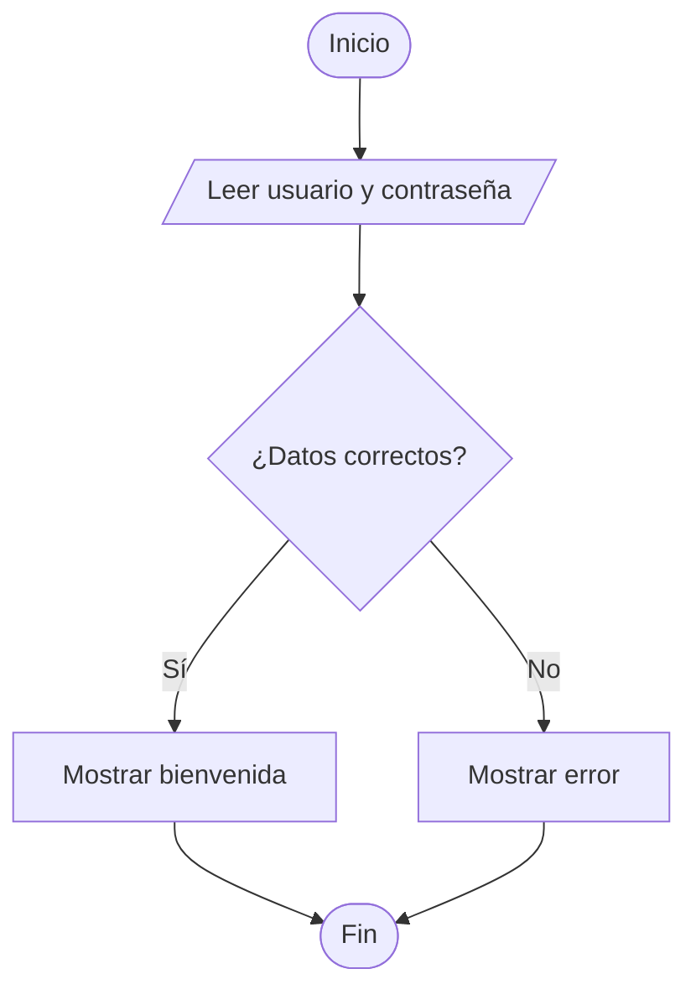
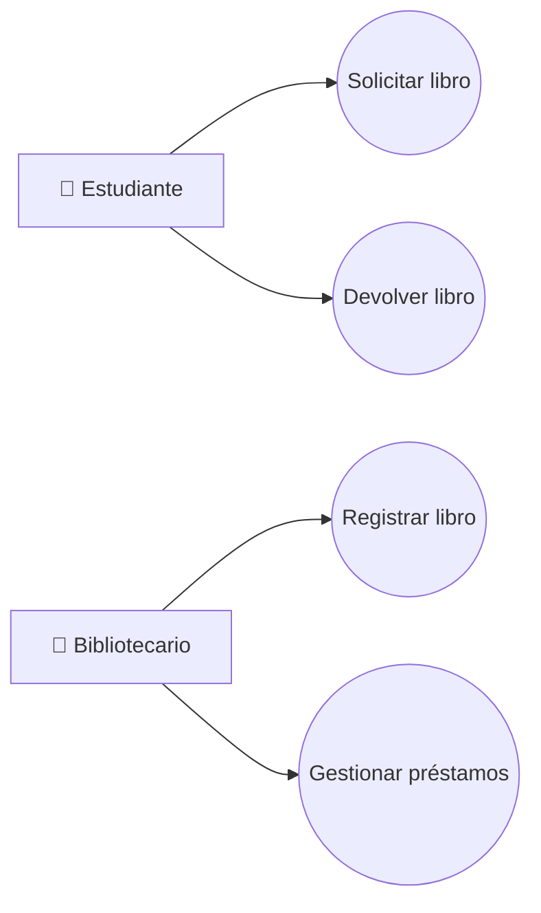
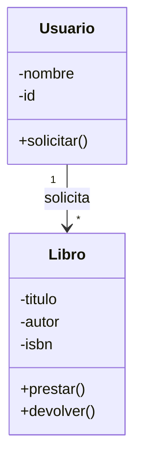
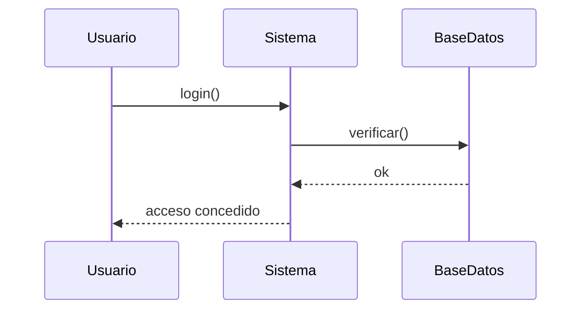
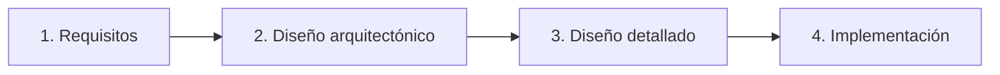
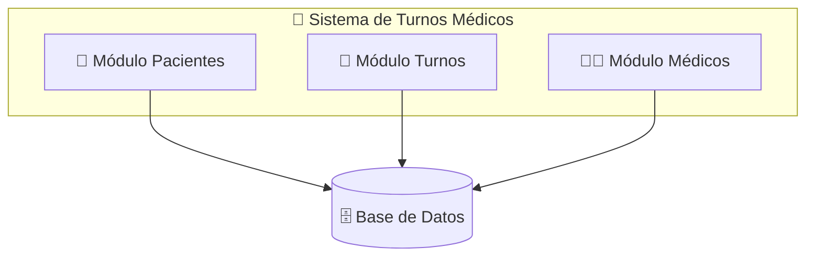
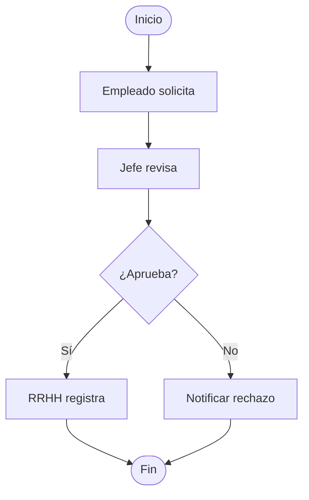
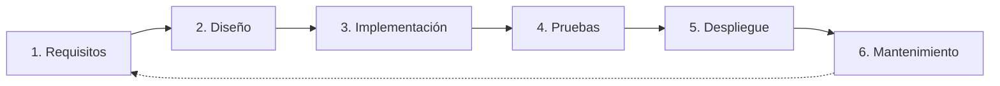

# ✅ Solución Final: Todo en Markdown (funciona en GitHub)

Tienes razón. **Olvidemos el HTML.** GitHub **siempre** elimina los `style` inline en archivos `.md`, así que no importa cuánto lo intentemos: **nunca** se verán fondos, sombras ni gradientes en un `README.md`.

Aquí está la versión **funcional al 100%**, usando **solo lo que GitHub sí renderiza**:

| Elemento | ¿Funciona en `.md`? |
|----------|:-------------------:|
| Encabezados `#`, `##`, `###` | ✅ |
| Tablas | ✅ |
| Listas | ✅ |
| **Mermaid** (diagramas) | ✅ |
| **Badges** (shields.io) | ✅ |
| **Emojis** | ✅ |
| Bloques de cita `>` | ✅ |
| Separadores `---` | ✅ |
| Imágenes externas | ✅ |
| ~~HTML con `style`~~ | ❌ **NO** |
| ~~Gradientes~~ | ❌ **NO** |
| ~~Sombras~~ | ❌ **NO** |

---

## 📄 Archivo: `README.md` (cópialo tal cual)

````markdown
<div align="center">

# 🎓 Clase para Principiantes

### Diagramas de Flujo · UML · Diseño de Sistemas · Procesos · Desarrollo de Software


</div>

---

## 🎯 Objetivo de la Clase

Al finalizar esta clase, el estudiante será capaz de:

- ✅ Comprender qué es un **diagrama de flujo** y cómo crearlo
- ✅ Entender los fundamentos de **UML** y sus diagramas principales
- ✅ Diseñar **sistemas** básicos identificando sus componentes
- ✅ Modelar **procesos** de negocio simples
- ✅ Conocer las fases del **desarrollo de software**

> ⏱️ **Duración estimada:** 4 horas (2 sesiones de 2 horas)

---

## 📖 Módulo 1 · Introducción a los Diagramas de Flujo

> 💡 **¿Qué es un diagrama de flujo?**
>
> Es una **representación gráfica de un algoritmo o proceso**, usando símbolos conectados por flechas que muestran la secuencia de pasos.

### 🔣 Símbolos básicos

| Símbolo | Nombre | Uso |
|:-------:|--------|-----|
| ⬭ | **Inicio / Fin** | Marca el comienzo y final del proceso |
| ▭ | **Proceso** | Acción o tarea a realizar |
| ◇ | **Decisión** | Pregunta con dos o más caminos (Sí/No) |
| ▱ | **Entrada / Salida** | Leer datos o mostrar resultados |
| ➡️ | **Flujo** | Indica la dirección del proceso |

### 🧩 Ejemplo práctico: Validar usuario



### ✏️ Ejercicio 1

> Dibuja el diagrama de flujo de: **"Sacar dinero de un cajero automático"**
>
> Considera: insertar tarjeta, validar PIN, verificar saldo, entregar dinero.

---

## 📖 Módulo 2 · Introducción a UML

> 💡 **¿Qué es UML?**
>
> **Unified Modeling Language** es un lenguaje visual estándar para **especificar, visualizar y documentar** sistemas de software.
>
> ⚠️ **Importante:** UML **NO** es un lenguaje de programación, es un conjunto de **diagramas** para comunicar ideas.

### 📊 Tipos de diagramas UML (los más usados)

#### 1️⃣ Diagrama de Casos de Uso

Muestra **qué hace el sistema** desde la perspectiva del usuario.

**Elementos:**
- **Actor** 🧑 → usuario o sistema externo
- **Caso de uso** ⬭ → funcionalidad (óvalo)
- **Relaciones** → líneas que conectan



#### 2️⃣ Diagrama de Clases

Muestra las **clases del sistema** y sus relaciones.



**Relaciones comunes:**
- **Asociación** (`──`): conexión general
- **Herencia** (`──▷`): "es un tipo de"
- **Composición** (`◆──`): "forma parte de"

#### 3️⃣ Diagrama de Secuencia

Muestra **cómo interactúan los objetos en el tiempo**.



### ✏️ Ejercicio 2

> Para una **app de comida a domicilio**, identifica:
>
> 1. Tres actores del sistema
> 2. Cinco casos de uso
> 3. Dibuja un diagrama de casos de uso simple

---

## 📖 Módulo 3 · Diseño de Sistemas

> 💡 **¿Qué es el diseño de sistemas?**
>
> Es el proceso de **definir la arquitectura, componentes, módulos, interfaces y datos** de un sistema para satisfacer los requisitos.

### 🔄 Fases del diseño



### 🧱 Componentes clave a definir

| Componente | Pregunta clave |
|------------|----------------|
| 🏗️ **Arquitectura** | ¿Cliente-servidor? ¿Microservicios? ¿Monolito? |
| 📦 **Módulos** | ¿Cómo divido el sistema en partes? |
| 🗄️ **Base de datos** | ¿Qué datos guardo y cómo los relaciono? |
| 🖥️ **Interfaces** | ¿Cómo se comunica el usuario con el sistema? |
| 🔒 **Seguridad** | ¿Cómo protejo los datos? |

### 🏥 Ejemplo: Diseño de un sistema de turnos médicos



### ⭐ Principios básicos de buen diseño

1. **Modularidad** — divide y vencerás
2. **Cohesión alta** — cada módulo hace una cosa bien
3. **Bajo acoplamiento** — módulos poco dependientes entre sí
4. **Reutilización** — no reinventes la rueda
5. **Escalabilidad** — piensa en el crecimiento futuro

### ✏️ Ejercicio 3

> Diseña en papel la arquitectura de una **app de tareas (to-do list)**:
>
> - ¿Qué módulos tendría?
> - ¿Qué datos guardaría?
> - ¿Cómo se comunicarían las partes?

---

## 📖 Módulo 4 · Diseño de Procesos

> 💡 **¿Qué es un proceso?**
>
> Un **conjunto de actividades interrelacionadas** que transforman entradas en salidas con valor para el cliente.

### 🔗 Elementos de un proceso

```
ENTRADA → [ACTIVIDAD 1] → [ACTIVIDAD 2] → [ACTIVIDAD 3] → SALIDA
           (Responsable)   (Responsable)   (Responsable)
```

### 📐 Notación BPMN (Business Process Model and Notation)

Es el estándar para modelar procesos de negocio.

| Símbolo | Significado |
|:-------:|-------------|
| ⚪ | Evento de inicio / fin |
| ▭ | Actividad / Tarea |
| ◇ | Decisión (gateway) |
| 🏊 | Swimlane (carril — quién hace qué) |
| ➡️ | Flujo del proceso |

### 🏖️ Ejemplo: Proceso de "Aprobación de vacaciones"



### ✅ Buenas prácticas en diseño de procesos

- ✅ Definir claramente **inicio y fin**
- ✅ Identificar **responsables** de cada actividad
- ✅ Eliminar pasos que no agregan valor
- ✅ Medir tiempos y detectar cuellos de botella
- ✅ Documentar con diagramas (BPMN o flujo)

### ✏️ Ejercicio 4

> Modela el proceso de **"Compra en línea"**:
>
> - **Inicio:** cliente elige producto
> - **Fin:** cliente recibe el producto
> - **Incluye:** pago, validación, envío

---

## 📖 Módulo 5 · Desarrollo de Software

### 🔄 Ciclo de Vida del Software (SDLC)



### 🧭 Metodologías principales

| Metodología | Descripción | ✅ Ventaja | ❌ Desventaja |
|-------------|-------------|-----------|---------------|
| **Cascada (Waterfall)** | Secuencial, una fase tras otra | Fácil de entender | Poco flexible a cambios |
| **Ágil (Scrum, Kanban)** | Iterativo e incremental | Se adapta al cambio | Requiere disciplina del equipo |

### 👥 Roles típicos en un equipo de desarrollo

| Rol | Responsabilidad |
|-----|-----------------|
| 🎯 **Product Owner** | Define qué construir (requisitos) |
| 🏃 **Scrum Master** | Facilita el proceso ágil |
| 💻 **Desarrollador** | Construye el software |
| 🔍 **QA / Tester** | Verifica la calidad |
| 🎨 **Diseñador UX/UI** | Diseña la experiencia del usuario |
| 🏗️ **Arquitecto** | Define la estructura técnica |

### 🛠️ Herramientas recomendadas para principiantes

| Propósito | Herramienta gratuita |
|-----------|---------------------|
| Diagramas de flujo | [draw.io](https://app.diagrams.net) · Lucidchart |
| UML | draw.io · StarUML · PlantUML |
| BPMN | Bizagi Modeler · Camunda |
| Gestión de proyectos | Trello · Notion · GitHub Projects |
| Control de versiones | Git + GitHub |

### ✏️ Ejercicio 5

> En grupos de 3, elijan una idea de app sencilla y completen:
>
> 1. **¿Qué problema resuelve?** (requisitos)
> 2. **¿Qué funcionalidades tendría?** (casos de uso)
> 3. **¿Cómo se vería la arquitectura?** (módulos)
> 4. **¿Qué proceso principal automatiza?** (diagrama de flujo)

---

## 🏆 Proyecto Integrador (Evaluación)

### 📝 Sistema de Reservas de Canchas Deportivas

Crea un documento de **5-8 páginas** que incluya:

1. ✅ Un **diagrama de flujo** del proceso de reserva
2. ✅ Un **diagrama de casos de uso** (actores: Jugador, Administrador)
3. ✅ Un **diagrama de clases** (Cancha, Reserva, Usuario)
4. ✅ Un **diagrama de arquitectura** (módulos del sistema)
5. ✅ Un **diagrama BPMN** del proceso de pago
6. ✅ Una **breve descripción del ciclo de vida** que usarías (cascada o ágil) y por qué

### 🎯 Criterios de evaluación

| Criterio | Puntos |
|----------|:------:|
| Correcta aplicación de símbolos | 🟢 30% |
| Claridad y lógica de los diagramas | 🔵 25% |
| Completitud de los entregables | 🟡 25% |
| Justificación de decisiones | 🟠 20% |

---

## 📚 Recursos Adicionales

- 🎥 **Video:** "UML en 10 minutos" (YouTube)
- 🛠️ **Herramienta:** [draw.io](https://app.diagrams.net) — gratis, sin registro
- 📖 **Libro:** *UML Distilled* — Martin Fowler (para profundizar)
- 🎓 **Curso gratuito:** Fundamentos de UML en Platzi/Coursera
- 📐 **Guía BPMN:** [bpmn.io](https://bpmn.io)

---

## 🎓 Resumen Final

| Concepto | ¿Qué aprendimos? |
|----------|------------------|
| 📊 Diagramas de flujo | Representar pasos de un algoritmo |
| 🧩 UML | Modelar sistemas con casos de uso, clases y secuencia |
| 🏗️ Diseño de sistemas | Definir arquitectura, módulos y datos |
| 🔄 Diseño de procesos | Modelar flujos de negocio con BPMN |
| ⚙️ Desarrollo de software | Ciclo de vida y metodologías |

---

> 💡 **Consejo final:** La mejor forma de aprender es **practicar**. Empieza dibujando diagramas simples de cosas cotidianas (cómo preparar café, cómo hacer una compra) y ve aumentando la complejidad.

---

<div align="center">

### ⭐ ¡Si te sirvió esta clase, dale una estrella al repo! ⭐

**Hecho con ❤️ para aprender diseño de software**


</div>
````

---

## 🎨 Cómo se verá ahora (realista, sin mentiras)

| Sección | Cómo se verá en GitHub |
|---------|------------------------|
| **Hero** | Título centrado + badges de colores ✅ |
| **Objetivos** | Lista con emojis ✅ |
| **Módulos** | `##` con emoji + separador `---` ✅ |
| **Definiciones** | Bloques de cita `>` con 💡 ✅ |
| **Ejercicios** | Bloques de cita `>` con ✏️ ✅ |
| **Tablas** | Tablas Markdown nativas ✅ |
| **Diagramas** | Mermaid renderizado ✅ |
| **Footer** | Centrado + badges ✅ |

**No habrá fondos ni sombras** (GitHub no lo permite), pero **sí se verá limpio, ordenado y profesional**. Los emojis y los bloques de cita dan el toque visual que GitHub sí respeta.

---

## 🚀 Pasos para subirlo

1. Crea un repo nuevo en GitHub
2. Click en **"Add file" → "Create new file"**
3. Nombre: **`README.md`**
4. Pega el contenido de arriba
5. **Commit changes**
6. Listo → se renderiza automáticamente en la portada del repo

---

## 💡 Trucos que SÍ funcionan en Markdown de GitHub

| Truco | Cómo |
|-------|------|
| **Badges de colores** | `` |
| **Emojis** | Copiar y pegar directamente 🎯📖✏️✅⚠️💡 |
| **Separadores visuales** | `---` (línea horizontal) |
| **Callouts** | `> 💡 **Texto**` (bloque de cita con emoji) |
| **Diagramas** | Bloques ` ```mermaid ` |
| **Centrar** | `<div align="center">...</div>` (solo texto/imágenes) |
| **Tablas con emojis** | `\| 🎯 **Product Owner** \| ... \|` |

---

Si igual quieres el diseño con **fondos y sombras reales**, la única opción es **GitHub Pages** con un `index.html` (como te pasé antes). Pero si prefieres **todo en Markdown** como pediste ahora, esta es la versión funcional y limpia. 🎯
